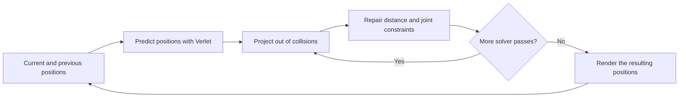
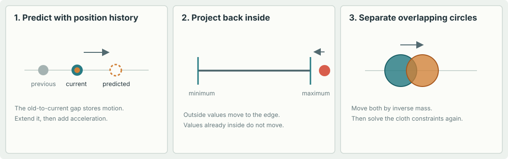
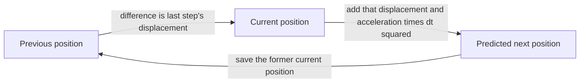

# Verlet fundamentals
> [Guide home](../readme.md) | [Next: Collisions and constraints](02_collisions_and_constraints.md)

---

## 1. The big idea

A real-time game simulation has a limited amount of time to update the world for each image on screen. It does not need to reproduce nature perfectly; it needs to look believable, stay stable, and run quickly.

Jakobsen's method represents objects as **particles** (points with positions) connected by **constraints** (rules about where those points may be). Each frame, the program:

1. Predicts where every particle will move.
2. Repairs positions that violate rules, such as a stick becoming too long or a point going through a wall.
3. Repeats the repairs a small number of times.

A constraint is not a spring force. It is a rule that the solver actively tries to satisfy. A distance constraint says, for example, “these two points should remain 100 units apart.” This avoids the stiff springs and tiny time steps that can make ordinary spring simulations unstable.



The method is **iterative**: it improves a result by repeating a simple operation. That makes it possible to trade speed for accuracy. Two solver passes cost less than ten; ten passes will usually make connected shapes hold their form more tightly.

The animation below loops through three small examples: position history predicts the next movement, a point outside a boundary is clamped back to the edge, and overlapping circles are projected apart. The dots are only illustrations; the equations and code later in this chapter define the actual simulation.



### One picture to keep in mind

Imagine a net made of dots and pieces of string. Gravity moves the dots. Whenever a string gets too long or short, move its endpoints until the string is closer to its intended length. Whenever a dot goes through a wall, move it back to the allowed side. Repeat. That is the core of the method.

---

## 2. Particles without stored velocity

A common simulation stores each particle's position `x` and velocity `v`. Jakobsen's version stores its **current position** `x` and **previous position** `x_old` instead. The difference between them tells us how far it moved during the last step:

```text
implicit displacement = x - x_old
```

For a fixed time step `dt`, the displacement approximates velocity multiplied by time:

```text
velocity ≈ (x - x_old) / dt
```

So velocity has not disappeared; it is encoded in the pair of positions. This is useful because collision and constraint corrections directly change position, and the next step naturally uses that corrected position history.

### Tiny numeric example

Suppose a particle is currently at `x = 10` and was previously at `x_old = 8`. Its last-step displacement was `2` units. With no acceleration, the next prediction is:

```text
x_next = 10 + (10 - 8) = 12
```

The particle continues in the same direction by the same displacement.

### Why initialize the old position correctly?

To give a particle an initial velocity `v0`, initialize:

```python
old_position = position - v0 * dt
```

If current and old positions start equal, the initial displacement is zero, so the particle starts at rest.

---

## 3. Verlet integration, carefully

For constant acceleration `a` and a fixed time step `dt`, the position-based Verlet update is:

$$
x_{next} = x + (x - x_{old}) + a\,dt^2
$$

After calculating the new position, save the former current position as the new history:

$$
x_{old,next} = x
$$

In Python with `pygame.Vector2`:

```python
def verlet_step(position, old_position, acceleration, dt, damping=1.0):
    displacement = (position - old_position) * damping
    next_position = position + displacement + acceleration * dt * dt
    return next_position, position.copy()
```

The `.copy()` matters: `pygame.Vector2` is mutable. If `old_position` refers to the same vector object as `position`, changing one can accidentally change both.



Follow the arrows: the gap from `OLD` to `CURRENT` represents recent movement. Extend that same movement from `CURRENT` to predict `NEXT`, then gravity adds its own small change. The loop keeps the two position samples needed for the next prediction.

### What damping does

The paper notes that replacing the coefficient 1 on the displacement with a value slightly below 1 introduces drag:

$$
x_{next} = x + d(x - x_{old}) + a\,dt^2, \quad 0 < d \leq 1
$$

Here `d` is a damping factor. For example, `d = 0.99` slowly reduces motion. Damping is a practical artifice: it removes energy and can help motion settle, but too much makes everything sluggish.

### Units and time steps

Be consistent about units. If position is measured in pixels, acceleration should be pixels per second squared and `dt` seconds. The displacement `x - x_old` is then the distance traveled in one simulation step; an initial physical velocity must be multiplied by `dt` when stored as a displacement.

Use a **fixed time step** for the physics. A variable step changes how much time the implicit displacement represents and can make the simulation unstable or inconsistent. A common game loop accumulates real elapsed time and runs zero or more fixed-size physics steps before drawing.

> In a few of the project's early examples, the previous-position difference is treated as a per-frame displacement, while gravity is multiplied by `dt²`. That can be useful for experimentation, but it mixes conventions. The complete example in Section 12 uses seconds consistently.

### Verlet compared with Euler

A basic explicit Euler update stores velocity and does roughly:

```python
velocity += acceleration * dt
position += velocity * dt
```

Position Verlet instead stores position history. Neither formula is magic, and position Verlet is not always more accurate than every velocity-based integrator. Its appeal here is practical: velocity-like motion comes from positions, and projections can correct collisions and constraints without a separate impulse solver.

---
