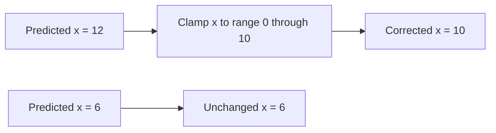
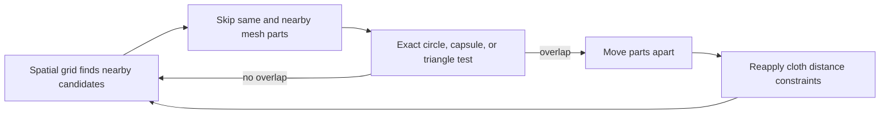
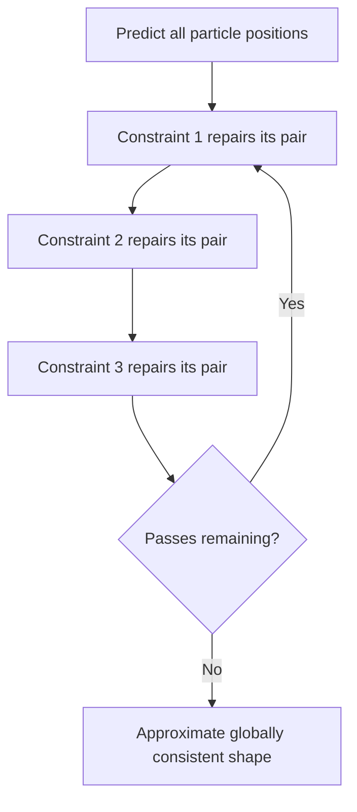
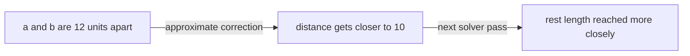

# Collisions and constraints
> [Previous: Verlet fundamentals](01_verlet_fundamentals.md) | [Next: Cloth and character bodies](03_cloth_and_character_bodies.md)

---

## 4. Collision by projection

A **collision** occurs when objects touch or overlap. A **contact** is a collision that persists, such as a box resting on the floor. This method handles both by correcting positions.

For a point inside a rectangular world, project each coordinate into its allowed range:

```python
def keep_inside_box(position, minimum, maximum):
    position.x = min(max(position.x, minimum.x), maximum.x)
    position.y = min(max(position.y, minimum.y), maximum.y)
```

This function **clamps** each coordinate: it keeps the value inside a minimum and maximum. Read the x expression from the inside out:

1. `max(position.x, minimum.x)` says “use whichever is larger: the current x or the minimum x.” This prevents x from going below the left boundary.
2. `min(..., maximum.x)` then says “use whichever is smaller: that result or the maximum x.” This prevents x from going beyond the right boundary.
3. The y line does the same thing between the top and bottom limits.

For example, with a minimum of `0` and maximum of `10`:

| Starting value | After `max(value, 0)` | After `min(result, 10)` | Final value |
|---:|---:|---:|---:|
| `-3` | `0` | `0` | `0` |
| `6` | `6` | `6` | `6` |
| `12` | `12` | `10` | `10` |

In other words, values that are already inside stay unchanged; values outside are moved to the nearest edge. `position` is modified directly, so the function does not need a `return` statement. This code treats the particle as a point. If it represents a circle with radius `r`, use `minimum=(r, r)` and `maximum=(world_width-r, world_height-r)` so its edge, not its center, stays inside the window. The same clamp is not enough for a rotated rectangle or an irregular body; those need shape-aware collision tests.



The diagram shows the same rule as the table: an outside value moves to the nearest allowed edge; an inside value passes through unchanged.

For example, if a particle's bottom edge is at `y = 610` but the floor is at `y = 600`, replace its `y` with `600`. The point is moved the smallest distance needed to become legal.

```text
Before:   point is below the floor
                    o
-------------------- floor

After:    point is projected onto the floor
                    o
-------------------- floor
```

The history position controls what happens to the implicit velocity. If we set both current and old `y` to the floor, the particle has no vertical displacement next step, corresponding to zero bounce in the normal direction. To add a bounce, change the history position so that the next displacement points away from the floor.

### Why this is simpler than a penalty spring

A penalty method pushes overlapping objects apart using a spring force. A very weak spring allows large overlap; a very stiff spring can make the simulation unstable unless the time step is very small. Projection directly repairs the illegal position, avoiding the need to tune a huge spring constant.

### What projection does not solve by itself

Projecting particle centers works well for simple particles and convex bounds. It does not automatically detect every way a large or non-convex shape can intersect geometry. The collision system must find candidate contacts and, for more complex shapes, provide useful contact points and penetration depths. [Section 9 in Cloth and character bodies](03_cloth_and_character_bodies.md#9-collisions-on-a-body-not-just-at-its-particles) explains how those contacts can move an entire particle-based body.

### Self-collision: when parts of one object hit each other

**Self-collision** means collision between parts that belong to the same simulated object. A cloth sheet folding onto itself is the common example. Ordinary distance constraints do not prevent this: they preserve selected distances, but two distant parts of the mesh can still pass through one another.

The basic process is the same as collision with the world:

1. Find pairs of parts that might touch.
2. Test those pairs accurately.
3. If they overlap, project them apart.
4. Reapply structural constraints, because the collision correction may have stretched the cloth.

#### Circle-like particles

Treat each particle as a circle with a collision radius. Two circles overlap when the distance between their centers is smaller than the sum of their radii. The following function moves both circles apart, weighted by inverse mass. A fixed circle has inverse mass `0` and will not move.

```python
import pygame as pg


def separate_circles(position_a, radius_a, inverse_mass_a,
                     position_b, radius_b, inverse_mass_b):
    delta = position_b - position_a
    distance_squared = delta.length_squared()
    target_distance = radius_a + radius_b

    if distance_squared >= target_distance * target_distance:
        return False  # They are touching or separated.

    total_inverse_mass = inverse_mass_a + inverse_mass_b
    if total_inverse_mass == 0.0:
        return False  # Both circles are fixed.

    if distance_squared == 0.0:
        # Their centers match, so there is no direction to normalize.
        normal = pg.Vector2(1, 0)
        distance = 0.0
    else:
        distance = distance_squared**0.5
        normal = delta / distance

    overlap = target_distance - distance
    position_a -= normal * overlap * inverse_mass_a / total_inverse_mass
    position_b += normal * overlap * inverse_mass_b / total_inverse_mass
    return True  # The pair was overlapping and has been corrected.
```

For example, if the radii are `4` and `3`, their centers must be at least `7` units apart. If they are only `5` units apart, the overlap is `2`; equal-mass circles each move `1` unit in opposite directions. The return value tells the caller whether a correction happened. In a cloth solver, call this for candidate non-neighboring particles during each solver pass, then solve the cloth's distance constraints again.

The zero-distance fallback is an arbitrary direction. It is deterministic and avoids division by zero, but many exactly coincident pairs may all separate along the same axis. A production solver can choose a stable direction based on the particle IDs or use a small initial separation.

#### Non-circular shapes

Circles are cheap, but a circle is a poor fit for a long limb or a flat piece of cloth. Use a shape that better matches the object:

| Shape proxy | Useful for | Typical collision test |
|---|---|---|
| Circle or sphere | Small particles, round objects | Compare center distance with summed radii. |
| Capsule | Rope segments, limbs, edges of cloth | Compare closest points on two line segments with the summed capsule radii. |
| Oriented box or convex polygon | Boxes and compact rigid parts | Use the separating-axis test (SAT). |
| Triangle mesh | Detailed static scenery or cloth surface | Use a broad-phase structure, then point-triangle or triangle-triangle tests. |

A **capsule** is a line segment with a circular radius around it. It models a long, rounded shape without testing every point on its surface. The next example performs one solver-pass correction for two overlapping capsule center-lines. It finds their closest points, then distributes the correction to the line endpoints according to their inverse masses and where the closest points lie along the lines.

```python
import pygame as pg


def _clamp01(value):
    return max(0.0, min(value, 1.0))


def closest_points_on_segments(a0, a1, b0, b1):
    """Return the closest points on 2D segments a0-a1 and b0-b1."""
    direction_a = a1 - a0
    direction_b = b1 - b0
    offset = a0 - b0
    length_a = direction_a.dot(direction_a)
    length_b = direction_b.dot(direction_b)
    epsilon = 1e-12

    if length_a <= epsilon and length_b <= epsilon:
        return a0, b0, 0.0, 0.0
    if length_a <= epsilon:
        amount_a = 0.0
        amount_b = _clamp01(direction_b.dot(offset) / length_b)
    elif length_b <= epsilon:
        amount_b = 0.0
        amount_a = _clamp01(-direction_a.dot(offset) / length_a)
    else:
        cross_term = direction_a.dot(direction_b)
        offset_a = direction_a.dot(offset)
        offset_b = direction_b.dot(offset)
        denominator = length_a * length_b - cross_term * cross_term

        if denominator > epsilon:
            amount_a = _clamp01(
                (cross_term * offset_b - offset_a * length_b) / denominator
            )
        else:
            amount_a = 0.0  # Parallel segments: start with one endpoint.

        amount_b = (cross_term * amount_a + offset_b) / length_b
        if amount_b < 0.0:
            amount_b = 0.0
            amount_a = _clamp01(-offset_a / length_a)
        elif amount_b > 1.0:
            amount_b = 1.0
            amount_a = _clamp01((cross_term - offset_a) / length_a)

    point_a = a0 + direction_a * amount_a
    point_b = b0 + direction_b * amount_b
    return point_a, point_b, amount_a, amount_b


def separate_capsules(positions, inverse_masses, endpoints_a, radius_a,
                      endpoints_b, radius_b):
    """Separate two capsules described by endpoint indices and radii."""
    a0_index, a1_index = endpoints_a
    b0_index, b1_index = endpoints_b
    a0, a1 = positions[a0_index], positions[a1_index]
    b0, b1 = positions[b0_index], positions[b1_index]

    point_a, point_b, amount_a, amount_b = closest_points_on_segments(
        a0, a1, b0, b1
    )
    delta = point_b - point_a
    distance_squared = delta.length_squared()
    target_distance = radius_a + radius_b

    if distance_squared >= target_distance * target_distance:
        return False

    coefficients = (
        1.0 - amount_a,
        amount_a,
        1.0 - amount_b,
        amount_b,
    )
    particle_indices = (a0_index, a1_index, b0_index, b1_index)
    signs = (-1.0, -1.0, 1.0, 1.0)
    denominator = sum(
        inverse_masses[index] * coefficient * coefficient
        for index, coefficient in zip(particle_indices, coefficients)
    )
    if denominator == 0.0:
        return False

    if distance_squared == 0.0:
        axis_a = a1 - a0
        axis_b = b1 - b0
        axis = axis_a if axis_a.length_squared() >= axis_b.length_squared() else axis_b
        normal = pg.Vector2(-axis.y, axis.x)
        if normal.length_squared() == 0.0:
            normal = pg.Vector2(1, 0)
        else:
            normal = normal.normalize()
        distance = 0.0
    else:
        distance = distance_squared**0.5
        normal = delta / distance

    amount = (target_distance - distance) / denominator
    for particle_index, coefficient, sign in zip(
        particle_indices, coefficients, signs
    ):
        inverse_mass = inverse_masses[particle_index]
        positions[particle_index] += (
            normal * (sign * inverse_mass * coefficient * amount)
        )
    return True
```

This is one **capsule-capsule positional correction**, not a complete character collision system. It repairs the current closest-point contact. Moving the endpoints can change which points are closest, so one call may leave a little overlap; call it again in later solver passes, then reapply the cloth or character's structural constraints. For example:

```python
for _ in range(collision_iterations):
    for capsule_pair in candidate_capsule_pairs:
        separate_capsules(*capsule_pair)
    solve_structural_constraints()
```

If both capsules belong to the same cloth or character, skip pairs that share endpoints or are close neighbors in the mesh; otherwise ordinary connected parts will constantly collide with themselves. Also avoid resolving the same pair twice in one pass. For boxes and other convex polygons, the separating-axis test (SAT) is a common alternative: project both shapes onto candidate axes; if any axis has a gap, they do not overlap. If every axis overlaps, choose the smallest overlap axis and push the shapes apart along it.

For triangle cloth, another common method treats each particle as a small sphere and tests it against triangles that are far enough away in the mesh's connectivity. This catches a vertex going through a remote triangle. Filtering out nearby triangles is essential, because a cloth vertex naturally touches its own adjacent triangles. More accurate methods also test edges against edges, but they are more expensive.

Self-collision can cost much more than ordinary cloth constraints. Checking every pair among `N` particles takes about `N * (N - 1) / 2` tests, which grows roughly as `N²`. The next optimization section explains how to avoid checking most pairs.



This is the self-collision loop. The grid is only a fast way to find possible pairs; the exact test decides whether a collision really happened. Filtering mesh neighbors prevents the solver from pushing normal connected parts away from each other.

---

## 5. Distance constraints and relaxation

A distance constraint connects two particles `a` and `b` and asks for a rest distance `L`:

$$
\lVert x_b - x_a \rVert = L
$$

Let `delta = x_b - x_a` and let `distance` be its length. For equal movable masses, split the correction evenly between the two endpoints:

```python
from math import hypot

def satisfy_distance(a, b, rest_length):
    delta = b - a
    distance = hypot(delta.x, delta.y)
    if distance == 0.0:
        return a, b  # Direction is undefined; choose a fallback in a full solver.

    error_fraction = (distance - rest_length) / distance
    correction = delta * (0.5 * error_fraction)
    return a + correction, b - correction
```

If the pair is too far apart, the first endpoint moves toward the second and the second moves toward the first. If they are too close, the correction reverses. After this operation, their distance is exactly the rest length, apart from floating-point rounding.

> The return-value version above makes the directions easy to inspect. A simulation that stores mutable vectors can instead update the two positions in place.

### Unequal masses and fixed particles

The paper handles different masses using **inverse mass**, written `w = 1 / mass`. A larger mass has a smaller inverse mass and therefore moves less. A fixed particle is represented with `w = 0`.

For `delta = b - a`, define `sum_w = w_a + w_b`. The correction is:

$$
c = \frac{\lVert\delta\rVert - L}{\lVert\delta\rVert\,sum_w}\,\delta
$$

$$
a' = a + w_a c, \qquad b' = b - w_b c
$$

Guard against zero distance and against `sum_w == 0` (both endpoints fixed). A fixed point must not move, even if its neighbor does.

### A reusable Python constraint function

```python
def solve_distance(positions, inverse_masses, index_a, index_b, rest_length):
    point_a = positions[index_a]
    point_b = positions[index_b]
    weight_a = inverse_masses[index_a]
    weight_b = inverse_masses[index_b]
    total_weight = weight_a + weight_b

    if total_weight == 0.0:
        return

    delta = point_b - point_a
    distance_squared = delta.length_squared()
    if distance_squared == 0.0:
        return

    distance = distance_squared**0.5
    correction = delta * ((distance - rest_length) / distance)
    point_a += correction * (weight_a / total_weight)
    point_b -= correction * (weight_b / total_weight)
```

### Why solve repeatedly?

Suppose one particle is part of several constraints. Fixing one string can break another. A cloth point might be connected to its left neighbor, right neighbor, upper neighbor, and lower neighbor. The simple solution is to visit constraints repeatedly:

```python
for _ in range(solver_iterations):
    for constraint in constraints:
        solve(constraint)
```

This repeated local repair is called **relaxation**. In the paper, the constraints are satisfied in sequence, so later repairs see earlier changes. This is often called a Gauss-Seidel-style iteration. A method that reads from one unchanged snapshot and writes into a separate buffer is Jacobi-style. Both are iterative solvers, but their convergence and implementation details differ.

Two to ten passes may be enough for a small interactive object; the right number depends on geometry, stiffness, motion, and frame budget. Too few passes can make shapes stretch. More passes cost more time. A common practical improvement is **substepping**: take multiple smaller physics steps per rendered frame, with a modest number of solver passes per step.



Relaxation is not a promise of exact global correctness after a fixed number of passes. It is a useful approximation: each pass tends to reduce local errors, but the whole system may still have some error when the frame ends.

---

## 6. A fast approximate constraint correction

Computing a square root for every constraint can be expensive in a large simulation. The paper describes a cheaper approximation that avoids the square root when the pair is already near its rest length.

Let:

- `delta = b - a`
- `distance_squared = delta.length_squared()`
- `rest_squared = rest_length * rest_length`
- `denominator = distance_squared + rest_squared`

Then the approximate correction is:

```python
correction = delta * (1.0 - 2.0 * rest_squared / denominator)
```

This looks difficult, but it is easier if we simplify the factor.

The part inside the parentheses is:

```python
1.0 - 2.0 * rest_squared / (distance_squared + rest_squared)
```

That is the same as:

```python
(distance_squared - rest_squared) / (distance_squared + rest_squared)
```

So the expression is really:

```python
factor = (distance_squared - rest_squared) / (distance_squared + rest_squared)
correction = delta * factor
```

This is much easier to read.

### What the factor is doing

The factor tells us how far the current length is from the desired length.

- If `distance_squared == rest_squared`, the factor is `0`.
- If the points are too far apart, `distance_squared > rest_squared`, so the factor is positive.
- If the points are too close, `distance_squared < rest_squared`, so the factor is negative.

That means:

- too long → correction pulls the points together
- too short → correction pushes them apart
- exact length → do nothing

This is exactly what a distance constraint should do.

### Why does it become zero at the correct length?

When the current distance is the target distance:

```python
distance_squared = rest_squared
```

Then:

```python
(distance_squared - rest_squared) / (distance_squared + rest_squared)
= (rest_squared - rest_squared) / (rest_squared + rest_squared)
= 0
```

So:

```python
correction = delta * 0 = 0
```

No movement happens. That is the whole point of a constraint: if the pair is already correct, leave it alone.

### Why does the sign change?

The sign tells us direction.

- If the pair is stretched, the factor is positive, so the correction moves the particles in the direction of `delta` and closes the gap.
- If the pair is compressed, the factor is negative, so the correction reverses direction and pushes the particles apart.

So the correction is not random. It is a measure of how much the current separation differs from the target separation.

### Why this is a useful approximation

The exact solver would calculate:

```python
distance = sqrt(delta.length_squared())
```

then use that value to correct the pair. That is more accurate but more expensive. The approximation instead uses squared distances only, which is cheaper and often good enough for cloth and particle systems.

This is a trade-off:

- lower cost
- simpler arithmetic
- less precision than an exact solver

The paper's key idea is not “never use square roots.” It is that sometimes a cheap approximation is enough for a stable simulation.

### The full approximate solver

```python
def satisfy_distance_approx(
    a,
    b,
    rest_length,
    inverse_mass_a=1.0,
    inverse_mass_b=1.0,
):
    delta = b - a
    distance_squared = delta.length_squared()
    rest_squared = rest_length * rest_length
    denominator = distance_squared + rest_squared
    total_inverse_mass = inverse_mass_a + inverse_mass_b

    if denominator == 0.0 or total_inverse_mass == 0.0:
        return a, b

    factor = (distance_squared - rest_squared) / (distance_squared + rest_squared)
    correction = delta * factor
    move_a = correction * (inverse_mass_a / total_inverse_mass)
    move_b = correction * (inverse_mass_b / total_inverse_mass)
    return a + move_a, b - move_b
```

Here is what each step means:

1. `delta = b - a` gives the vector between the two points.
2. `distance_squared` is the current squared distance.
3. `rest_squared` is the desired squared distance.
4. The factor tells us how much the current length should change.
5. `inverse_mass_a / total_inverse_mass` and `inverse_mass_b / total_inverse_mass` split the correction according to mass.
6. The function returns the corrected positions.

### Worked example

Let:

- `a = (0, 0)`
- `b = (12, 0)`
- `rest_length = 10`

Then:

```text
delta = (12, 0)
distance_squared = 12 * 12 = 144
rest_squared = 10 * 10 = 100
denominator = 144 + 100 = 244
```

The factor becomes:

```text
1 - 2 * 100 / 244 = 1 - 200 / 244 = 0.18033
```

So:

```text
correction = (12, 0) * 0.18033 = (2.164, 0)
```

With equal masses, each point moves half of that correction. The result is a smaller gap, closer to the rest length. It does not become exactly `10` in one pass, because this is only an approximation.



### Unequal masses

If one particle is heavier, it should move less. That is why inverse mass is used:

```python
inverse_mass_a = 1.0 / mass_a
inverse_mass_b = 1.0 / mass_b
```

A larger mass gives a smaller inverse mass, so the heavier particle moves less. A fixed particle has inverse mass `0.0`, so it does not move at all.

The important idea is simple:

> The correction is computed once, then shared between the endpoints according to their inverse masses.

This keeps the solver stable while still respecting different masses.

---
