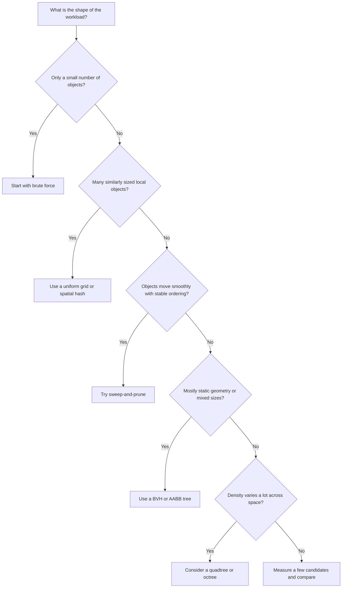
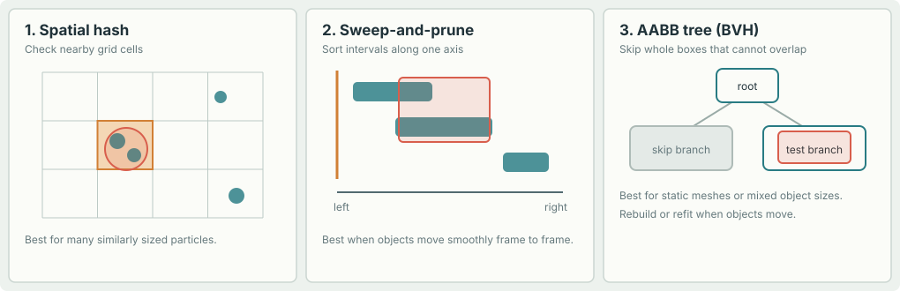
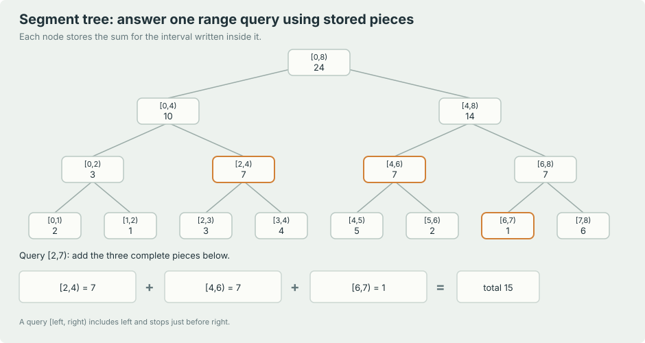
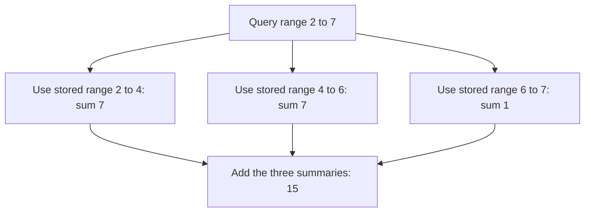

# Game optimization
> [Previous: Cloth and character bodies](03_cloth_and_character_bodies.md) | [Next: Complete example and reference](05_complete_example_and_reference.md)

---

## 11. Motion control, friction, and practical details

### Applying an impulse or animation motion

Because velocity is encoded by current and old positions, changing the current position changes the next displacement. Moving a particle in the direction of a hit gives it motion. To avoid accidentally adding a velocity spike, distinguish between:

- **Teleporting or pinning:** update both current and old positions.
- **Giving a kick:** change current position relative to old position.
- **Following a moving target:** update the target and decide whether its movement should transfer to the simulated object.

A traditional animation can hand off motion by supplying particle positions from two successive animation frames; their difference becomes the initial Verlet displacement.

### Friction

Projection alone removes motion into a surface, but leaves motion along it. That makes an object slide like it is on ice. A simple friction approximation is:

1. Save the particle's displacement before projection.
2. Split it into normal and tangential parts.
3. Reduce tangential displacement according to friction and penetration depth.
4. Update the old position to encode the reduced displacement.

For a unit surface normal `n` and displacement `v = x - x_old`:

$$
v_n = (v\cdot n)n, \qquad v_t = v-v_n
$$

One simple reduction is:

$$
v_t' = \max\left(0, 1 - \frac{\mu d_p}{\lVert v_t\rVert}\right)v_t
$$

where `mu` is a friction factor and `d_p` is a measure of penetration before projection. Clamp the multiplier at zero so friction does not reverse the sliding direction. Set the old position to `x - (v_n + v_t')` after projection. This is a heuristic, not a full Coulomb friction solver; its behavior depends on how penetration and units are defined.

### Fast motion and tunneling

A fast point can move from one side of a thin wall to the other between updates without ever being detected inside the wall. This is called **tunneling**. Reduce the risk with:

- Smaller fixed steps or multiple substeps.
- Swept tests from the previous to the predicted position.
- A swept sphere/capsule for objects with a radius.
- A sensible maximum speed or time-step limit where appropriate.

A swept test checks the path, not just the final point. The paper describes a simple midpoint-path test as a practical solution for fast objects.

### Collision-search optimization techniques

Before optimizing, separate collision work into two steps:

- The **broad phase** quickly finds pairs that might collide. It should avoid false negatives, but it is allowed to return extra pairs.
- The **narrow phase** performs the accurate shape test for each candidate pair.

Without a broad phase, comparing every object with every other object takes about `N² / 2` pair checks. At `N = 1,000`, that is nearly 500,000 pairs per update. A broad phase tries to make the candidate list much smaller. These are common choices:

| Technique | Simple explanation | Good fit | Limitation |
|---|---|---|---|
| Uniform grid / spatial hash | Divide space into same-sized cells; only compare objects that occupy the same or nearby cells. A spatial hash stores cells in a dictionary keyed by integer cell coordinates. | Many similarly sized particles, bullets, or local cloth contacts. | Large objects cover many cells; cell size needs tuning. |
| Quadtree / octree | Recursively split 2D space into four regions or 3D space into eight. | Unevenly distributed objects across a large world. | More bookkeeping; objects crossing region boundaries need careful handling. |
| BVH / AABB tree | Group objects under bounding boxes; reject a whole group when its box cannot overlap the query. | Static triangle meshes, large objects, and mixed object sizes. | Moving objects may require updating or rebuilding the tree. |
| Sweep-and-prune | Sort object bounds along an axis; only compare objects whose intervals overlap, then check other axes. | Many objects with coherent motion between frames. | Can degrade when many intervals overlap or ordering changes greatly. |
| Segment tree | Store intervals in a balanced tree so interval-overlap queries can be fast. | One-dimensional interval queries, such as time ranges or projected bounds along one axis. | Not a general 2D/3D collision structure; a BVH or spatial hash is usually more direct for game-world geometry. |

A segment tree is sometimes useful inside a collision algorithm, but it is not automatically the right answer to “how do I speed up collisions?” For a typical 2D particle cloth, start with a uniform grid or spatial hash. For a triangle world, a BVH or an engine's existing static-mesh collision structure is often a better fit.

#### Which technique should I try first?

Start with the simplest choice that matches how your objects are arranged and move. There is no data structure that is fastest for every game.

| Your situation | Good first choice | Why |
|---|---|---|
| Only a few dozen objects, or you need a correctness baseline | Brute force | Very little code and no indexing overhead. |
| Many particles of similar size, with mostly nearby interactions | Uniform grid / spatial hash | Objects only compare against occupants of nearby cells. |
| Objects move smoothly and their left-to-right order changes slowly | Sweep-and-prune | The previous frame's sorted order is often almost correct. |
| Static scenery, triangle meshes, or objects with very different sizes | BVH / AABB tree | A query can reject a whole distant group using one bounding box. |
| Objects are unevenly spread across a large 2D or 3D region | Quadtree / octree | Regions with few objects can be skipped; dense regions can be split further. |
| You need sums, counts, or another aggregate over an indexed 1D range | Segment tree | Stored interval summaries answer range queries efficiently. |





All of these are **broad-phase** methods. They produce possible pairs. You still need an accurate **narrow-phase** test, such as circle-circle distance or capsule-triangle contact, before moving objects. A good broad phase must never miss a real collision; returning a few extra pairs is acceptable.

##### Brute force: keep the simple baseline

For a small number of objects, test every distinct pair. It is easy to implement, and it is an important reference: a faster method should return the same real pairs as this simple version.

```python
from itertools import combinations


def aabbs_overlap(box_a, box_b):
    min_ax, min_ay, max_ax, max_ay = box_a
    min_bx, min_by, max_bx, max_by = box_b
    return (
        min_ax <= max_bx
        and max_ax >= min_bx
        and min_ay <= max_by
        and max_ay >= min_by
    )


def brute_force_candidates(boxes):
    return [
        (index_a, index_b)
        for index_a, index_b in combinations(range(len(boxes)), 2)
        if aabbs_overlap(boxes[index_a], boxes[index_b])
    ]
```

With `N` objects this checks `N * (N - 1) / 2` pairs. For 20 objects that is only 190 checks, which may be cheaper than building and maintaining a more complex index. Use brute force as a real option for small scenes, tests, or as a reference when validating a new broad phase.

#### Segment tree: split a range into stored pieces

A **segment tree** is a tree built over a line of values. Each leaf represents one value. Each parent stores a summary of all the values below it. In the example below, the summary is the **sum**:

- The leaves store the eight values `[2, 1, 3, 4, 5, 2, 1, 6]`.
- The node `[0,4)` represents values at indices 0 through 3, whose sum is `10`.
- Its children `[0,2)` and `[2,4)` have sums `3` and `7`; together they make `10`.
- The root `[0,8)` stores the sum of the whole array, `24`.

The interval notation `[left, right)` includes `left` but stops before `right`. So `[2,7)` means indices 2, 3, 4, 5, and 6. This convention makes neighboring ranges fit together without counting a boundary index twice.



The animation highlights the three complete nodes that answer the query. The tree does not need to open every leaf in the requested range:



For example, the tree sees that `[2,4)` is fully inside the query, so it can take the stored sum `7` without looking at indices 2 and 3 separately. It does the same for `[4,6)`, then uses the leaf `[6,7)` for the last value. The result is `7 + 7 + 1 = 15`.

Here is a small **range-sum segment tree** in Python. `query(left, right)` returns the sum over `[left, right)`. It supports changing one array value with `update`.

```python
class SegmentTree:
    def __init__(self, values):
        self.length = len(values)
        self.size = 1
        while self.size < self.length:
            self.size *= 2

        # Leaves start at self.size. Unused leaves contain the sum identity, 0.
        self.tree = [0] * (2 * self.size)
        for index, value in enumerate(values):
            self.tree[self.size + index] = value

        # Each parent is the sum of its two children.
        for node in range(self.size - 1, 0, -1):
            self.tree[node] = self.tree[2 * node] + self.tree[2 * node + 1]

    def update(self, index, value):
        if not 0 <= index < self.length:
            raise IndexError("segment-tree index is out of range")

        node = self.size + index
        self.tree[node] = value
        node //= 2
        while node:
            self.tree[node] = self.tree[2 * node] + self.tree[2 * node + 1]
            node //= 2

    def query(self, left, right):
        if not 0 <= left <= right <= self.length:
            raise IndexError("query range is out of bounds")

        left += self.size
        right += self.size
        total = 0

        while left < right:
            if left % 2 == 1:
                total += self.tree[left]
                left += 1
            if right % 2 == 1:
                right -= 1
                total += self.tree[right]
            left //= 2
            right //= 2

        return total


values = [2, 1, 3, 4, 5, 2, 1, 6]
tree = SegmentTree(values)
print(tree.query(2, 7))  # 15: 3 + 4 + 5 + 2 + 1

tree.update(6, 4)        # Change the value at index 6 from 1 to 4.
print(tree.query(2, 7))  # 18: the queried sum changes by 3.
```

The tree is built in `O(n)` time. A point update and a range-sum query each take `O(log n)` time, because they visit only a small number of levels. The array used internally is padded to a power of two; padding leaves contain `0`, which does not change a sum.

##### What this means for collision detection

The code above answers questions like “what is the sum from index 2 through index 6?” It does **not** return a list of game objects whose bounding boxes overlap. Those are different queries.

For a collision broad phase, a common trick is to sort object start/end coordinates and sweep across one axis. A segment tree can then maintain a summary of active intervals, such as how many projected intervals cover each coordinate range. But a count alone does not tell the solver which object IDs to test. To report all overlapping objects, you need an augmented interval index that stores and returns object IDs, then you still check the other axis and run a narrow-phase shape test. For most games, a spatial hash, sweep-and-prune structure, or BVH is simpler and more directly suited to that job.

#### Small spatial-hash example for circles

This broad-phase function inserts each circle into every grid cell touched by its bounding box. It returns candidate pairs only; it does **not** prove that two circles overlap. Pass the returned pairs to `separate_circles` for the narrow-phase test and correction.

```python
from collections import defaultdict
from math import floor


def circle_candidate_pairs(positions, radii, cell_size):
    if cell_size <= 0.0:
        raise ValueError("cell_size must be positive")

    cells = defaultdict(list)

    for index, (position, radius) in enumerate(zip(positions, radii)):
        min_cell_x = floor((position.x - radius) / cell_size)
        max_cell_x = floor((position.x + radius) / cell_size)
        min_cell_y = floor((position.y - radius) / cell_size)
        max_cell_y = floor((position.y + radius) / cell_size)

        for cell_x in range(min_cell_x, max_cell_x + 1):
            for cell_y in range(min_cell_y, max_cell_y + 1):
                cells[(cell_x, cell_y)].append(index)

    pairs = set()
    for indices in cells.values():
        for offset, index_a in enumerate(indices):
            for index_b in indices[offset + 1:]:
                pairs.add((min(index_a, index_b), max(index_a, index_b)))

    return sorted(pairs)
```

Because a circle is inserted into every cell its bounds touch, circles that overlap must share at least one cell, assuming the same cell size and coordinate system. The `set` removes duplicate pairs caused by two large circles sharing multiple cells. In a cloth, filter out pairs that are immediate mesh neighbors before the narrow phase. If one object is vastly larger than the rest, put large objects in a separate list or use a tree so they do not occupy hundreds of grid cells.

Think of each grid cell as a bucket. The function computes the first and last bucket touched by each circle's bounding box, puts the circle's index in all those buckets, and compares only indices that share a bucket. It uses `floor`, not integer truncation, so positions left or above the origin map correctly into negative grid cells. `cell_size` must be greater than zero. A starting guess is around the diameter of a typical particle, then measure how many candidates the grid returns. Very large cells create too many local comparisons; very small cells make each object occupy many cells.

##### Sweep-and-prune: reuse a sorted axis

Every 2D axis-aligned box has a horizontal interval `[min_x, max_x]`. Sort boxes by `min_x`. While scanning from left to right, keep only boxes whose `max_x` has not fallen behind the current box. Those active boxes overlap on x; test their y intervals to see which are full 2D candidates.

```python
def sweep_and_prune(boxes):
    """Return overlapping AABB pairs; each box is (min_x, min_y, max_x, max_y)."""
    order = sorted(range(len(boxes)), key=lambda index: boxes[index][0])
    active = []
    pairs = []

    for current in order:
        min_x, min_y, max_x, max_y = boxes[current]
        active = [index for index in active if boxes[index][2] >= min_x]

        for other in active:
            _, other_min_y, _, other_max_y = boxes[other]
            if min_y <= other_max_y and max_y >= other_min_y:
                pairs.append((min(other, current), max(other, current)))

        active.append(current)

    return pairs


boxes = [
    (0, 0, 2, 2),
    (1, 1, 3, 3),  # Overlaps the first box.
    (4, 0, 5, 1),  # Too far to the right.
    (1, 4, 2, 5),  # Overlaps on x, but not on y.
]
print(sweep_and_prune(boxes))  # [(0, 1)]
```

This simple version sorts from scratch on every call. In a game, object order often changes only a little between frames; keeping the previous order and repairing nearby swaps can make sorting much cheaper. Sweep-and-prune is a good fit for moving rigid bodies in a compact scene. If many objects overlap along the sweep axis, the active list becomes large and it can fall back toward checking every pair.

##### BVH / AABB tree: reject whole groups

A **bounding volume hierarchy** (BVH) groups objects under larger bounding boxes. A query first checks the root box. If the query cannot overlap the root, there is nothing below it to test. If it overlaps only one child, the other whole branch is skipped. **AABB** means *axis-aligned bounding box*: a rectangle whose sides stay parallel to the x and y axes.

The code below builds a small binary AABB tree and returns the IDs of objects whose boxes overlap a query box. It is written for clarity; production engines use more advanced builders and refitting strategies.

The query reuses `aabbs_overlap` from the brute-force example above. Keep that helper in the same file, or copy it next to this example when trying the tree by itself.

```python
def bounds_union(boxes):
    return (
        min(box[0] for box in boxes),
        min(box[1] for box in boxes),
        max(box[2] for box in boxes),
        max(box[3] for box in boxes),
    )


def build_aabb_tree(items, leaf_size=2):
    """Build a tree from (object_id, (min_x, min_y, max_x, max_y)) items."""
    if not items:
        return None

    node_bounds = bounds_union([box for _, box in items])
    if len(items) <= leaf_size:
        return {"bounds": node_bounds, "items": items, "left": None, "right": None}

    width = node_bounds[2] - node_bounds[0]
    height = node_bounds[3] - node_bounds[1]
    axis = 0 if width >= height else 1
    sorted_items = sorted(
        items,
        key=lambda item: (item[1][axis] + item[1][axis + 2]) * 0.5,
    )
    middle = len(sorted_items) // 2
    left = build_aabb_tree(sorted_items[:middle], leaf_size)
    right = build_aabb_tree(sorted_items[middle:], leaf_size)
    return {"bounds": node_bounds, "items": None, "left": left, "right": right}


def query_aabb_tree(node, query_box, results=None):
    if results is None:
        results = []
    if node is None or not aabbs_overlap(node["bounds"], query_box):
        return results

    if node["items"] is not None:
        for object_id, object_box in node["items"]:
            if aabbs_overlap(object_box, query_box):
                results.append(object_id)
        return results

    query_aabb_tree(node["left"], query_box, results)
    query_aabb_tree(node["right"], query_box, results)
    return results


objects = [
    ("crate", (0, 0, 2, 2)),
    ("barrel", (3, 1, 5, 3)),
    ("wall", (20, 0, 24, 10)),
]
tree = build_aabb_tree(objects)
print(query_aabb_tree(tree, (1, 0, 4, 2)))  # ['crate', 'barrel']
```

The tree stores each object's box at a leaf and the union of child boxes at each parent. A query that misses a parent box skips every object below that parent. A balanced tree often visits about `O(log n + k)` nodes for a local query, where `k` is the number of returned candidates, but worst-case queries can still visit `O(n)` nodes. This simple builder sorts at each level; it is for learning, not the fastest construction method.

Use a BVH for static scenery, triangle meshes, or object sets with very different sizes. A static tree can be built once. For moving objects, either **refit** the boxes from the leaves upward or rebuild when the tree becomes poorly balanced. If the whole scene changes every frame, a spatial hash may be simpler.

##### Quadtrees and octrees: split busy regions more deeply

A quadtree does not split the entire world into a fixed grid. It splits a 2D region into four smaller regions, then splits a region again only if it contains too many objects. An octree does the same in 3D, using eight child regions. This can save work when objects are clustered in a few places and other regions are mostly empty.

Choose a quadtree for a large 2D world with uneven object density, such as a map with one busy city and lots of empty countryside. Choose an octree for the equivalent 3D workload. They add bookkeeping and can struggle when many large objects cross region boundaries; insert such objects at a parent that fully contains them, or use a BVH. A quadtree is unnecessary for a small, evenly populated cloth grid, where a uniform grid is simpler.

### Other useful game optimizations

#### Collision layers and masks: skip impossible pairs

Give each object a **layer** describing what it is, and a **mask** describing the layers it is allowed to touch. A bit mask is a compact set of yes/no flags. If two object types should never collide, reject the pair before doing any geometry work.

```python
def can_collide(layer_a, mask_a, layer_b, mask_b):
    a_accepts_b = (mask_a & layer_b) != 0
    b_accepts_a = (mask_b & layer_a) != 0
    return a_accepts_b and b_accepts_a


LAYER_CLOTH = 0b0001
LAYER_WORLD = 0b0010
LAYER_TRIGGER = 0b0100

cloth_mask = LAYER_WORLD
world_mask = LAYER_CLOTH
trigger_mask = LAYER_CLOTH

assert can_collide(LAYER_CLOTH, cloth_mask, LAYER_WORLD, world_mask)
assert not can_collide(LAYER_CLOTH, cloth_mask, LAYER_TRIGGER, trigger_mask)
```

Use masks for rules such as “cloth hits the world, but not its own trigger volume.” Both objects must allow the pair in this example. For self-colliding cloth, masks do not replace topology filtering: neighboring cloth particles still need to be excluded by mesh relationship.

#### Sleeping: stop updating settled objects

If an object has barely moved for a short time, it can **sleep**. A sleeping object skips integration, constraint solving, and collision queries until something wakes it, such as a new collision or player input. Check motion over multiple frames so a single slow frame does not put a moving object to sleep.

```python
import pygame as pg


def is_below_sleep_speed(position, previous_position, dt, speed_limit):
    displacement = position - previous_position
    maximum_step = speed_limit * dt
    return displacement.length_squared() < maximum_step * maximum_step


point = pg.Vector2(10, 20)
old_point = pg.Vector2(10, 20)
print(is_below_sleep_speed(point, old_point, 1 / 60, 0.1))  # True
```

The test uses squared lengths, so it avoids a square root. Use it to accumulate a sleep timer, and sleep only after every particle in a body has stayed below the threshold for a chosen duration. When the body is hit, dragged, or connected to an awake body, reset the timer and wake it. Choose a low threshold carefully: sleeping too soon makes bodies appear frozen.

#### Other practical wins

- **Topology filtering:** for self-colliding cloth, skip the same vertex, directly connected vertices, and often vertices a few edges away. This removes contacts that are guaranteed by the mesh structure to be harmless.
- **Simpler collision proxies:** collide capsules or boxes instead of every visible polygon when the visual difference is acceptable. This is useful for characters, where a few limb capsules are much cheaper than testing the full rendered mesh.
- **Early rejection:** test bounding circles or AABBs before exact shape tests. A cheap failed test means the expensive narrow phase is skipped.
- **Cache-friendly data:** process positions, radii, and inverse masses in predictable arrays; reuse candidate lists where practical instead of creating many temporary objects in a hot loop.
- **Bounded work:** cap solver passes and physics catch-up steps so a slow frame does not cause an unbounded backlog. Do not silently discard essential collision pairs; prioritize nearby or high-penetration contacts if a budget is reached.
- **Render culling:** skip drawing objects outside the camera view. This saves rendering work, but do not skip their physics if they can still collide with visible objects.
- **Profile before rewriting:** measure broad phase, narrow phase, constraint solving, and rendering separately. Optimize the part that actually consumes time.

#### A simple optimization order

1. Make a correct brute-force version for small test scenes.
2. Measure how many candidate pairs and exact tests it performs.
3. Add cheap rejection rules such as layers, masks, and AABB checks.
4. Choose a spatial structure that matches the object distribution.
5. Re-run the same tests and compare both results and frame time.

This order avoids a common trap: adding a sophisticated tree that costs more to maintain than the collision checks it saves. In Python especially, a clear algorithm with fewer object allocations can beat a complicated structure on small scenes.

For self-collision, run the broad phase again when particles move substantially during constraint solving, or use a conservative bound that covers their predicted movement. A stale candidate list can miss contacts created by the solver itself.

### Numerical singularities

When two constrained particles occupy exactly the same position, their separation direction is undefined. Avoid division by zero. Options include leaving the pair unchanged for that pass, using a known fallback direction, or separating the points slightly. Random nudges can break symmetry, but deterministic fallback directions are easier to reproduce in debugging.

### Soft constraints

A soft constraint repairs only a fraction of its error per pass. If a stick should be 100 units long but is 60, a 50% correction moves it halfway toward the target; later steps close the remaining gap. This creates stretchy or soft-looking material without adding spring forces.

---
